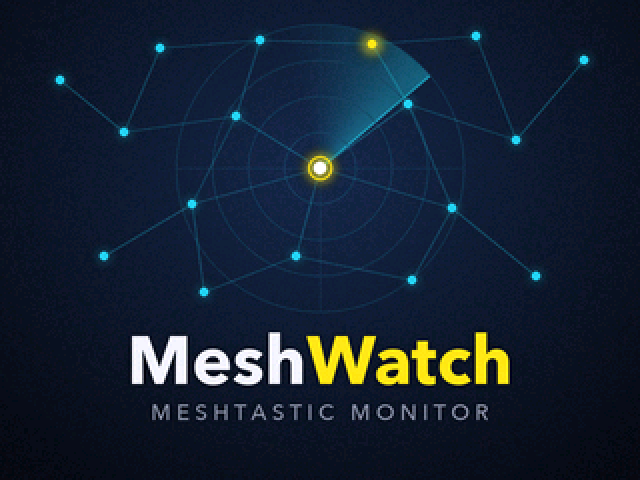
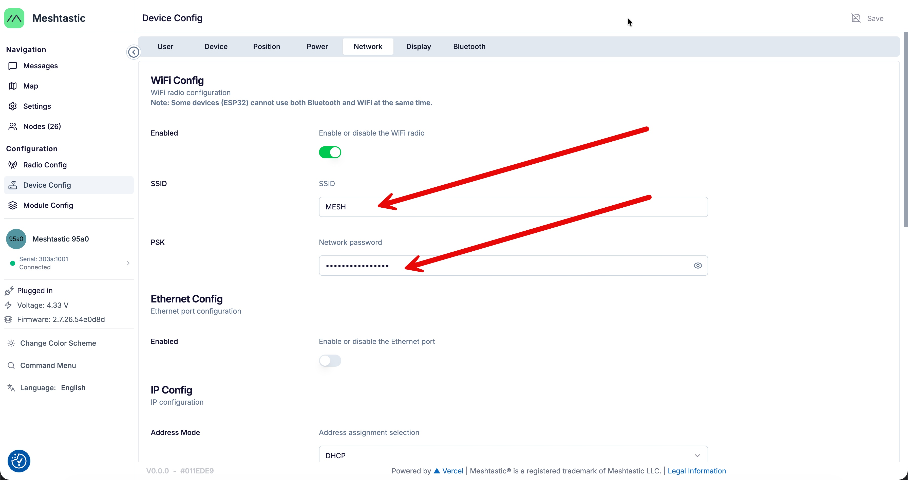

# ESP32-CYD-MeshWatch

**MeshWatch** turns an ESP32 "Cheap Yellow Display" (ESP32-2432S028, 2.8" 320×240 touchscreen) into a
standalone message monitor for your [Meshtastic](https://meshtastic.org) radio. It connects to the radio over
WiFi and shows the text messages, nodes and radio status on its screen, with no app, broker or server needed.



**Install it from your browser:** <https://hb9iiu.github.io/ESP32-CYD-MeshWatch/>

## Features

- **Messages:** text messages heard by your radio, with sender name, channel (or DM) and time, newest on top.
  The last 24 hours are kept in flash and come back after a power cut.
- **Nodes:** every node your radio knows, sorted by last heard, with hops or SNR and battery.
- **Info:** your radio's name, hardware, firmware, battery, channel use, airtime, uptime and LoRa settings,
  plus mesh statistics and MeshWatch's own network status.
- **Screensaver:** after two idle minutes a railway-style clock with a stop-to-go second hand appears and
  counts new messages; the backlight dims. A tap returns to the messages.
- **Automatic radio discovery:** MeshWatch scans the local network for the Meshtastic API (TCP port 4403)
  and remembers the radio's address. No IP address to configure.
- **QR code WiFi setup:** on first start the screen shows a QR code that joins the setup network; the setup
  page opens by itself.

## What you need

- An **ESP32-2432S028** ("CYD") board.
- A **Meshtastic radio with WiFi**, i.e. ESP32-based (Heltec, LilyGO T-Beam / T3, Station G2, …).
  nRF52 radios (RAK4631, T-Echo, …) have no WiFi and cannot be used.
- Both devices on the **same WiFi network**. Internet access is optional; it provides the clock time.

## Setup

### 1. Turn on WiFi on your radio

In the Meshtastic app or web client open **Device Config → Network**, enable WiFi, enter your network name
and password, and save. This also enables the network API (port 4403) that MeshWatch uses.



ESP32 radios cannot use Bluetooth and WiFi at the same time. With WiFi on, connect to the radio over the network
instead (Meshtastic web client or app via its IP address).

### 2. Install MeshWatch

Open the [web installer](https://hb9iiu.github.io/ESP32-CYD-MeshWatch/) in **Chrome or Edge on a desktop
computer**, connect the CYD by USB, click **Install MeshWatch** and choose its serial port. For a first install,
allow erasing the device. If no serial port appears, install the CH340 USB driver for your system.

### 3. Connect MeshWatch to your WiFi

After installing, the CYD shows a QR code. Scan it with your phone to join the open `MeshWatch-Setup` network;
the setup page opens automatically (otherwise browse to `192.168.4.1`). Enter the same WiFi network as your
radio. MeshWatch restarts, finds the radio and starts showing messages.

## Using MeshWatch

| Screen | What you see |
|---|---|
| Messages | Message cards; unread ones have a green edge and are counted in the header. Touch the list to mark them read. |
| Nodes | Name · last heard · hops or SNR (direct) · battery (`PWR` = external power). |
| Info | Radio, mesh and MeshWatch details; values the radio does not report show `-`. |

The dot next to the clock shows the radio link: green connected, amber connecting, red unreachable.
If the radio's address changes, MeshWatch scans the network again after three failed attempts.

## Building from source

The project uses [PlatformIO](https://platformio.org). All libraries are bundled in `lib/`, so the project
builds offline once the platform is installed:

```sh
pio run -e esp32-cyd              # build
pio run -e esp32-cyd -t upload    # build and flash over USB
pio device monitor                # serial log, 115200 baud
```

| Path | Contents |
|---|---|
| `src/main.cpp` | The application |
| `src/splash_image.c` | Boot splash bitmap, generated by `tools/make_splash.py` |
| `include/meshtastic_enums.h` | Hardware, role, region and preset names from the Meshtastic protobufs |
| `include/lv_conf.h` | LVGL configuration |
| `lib/` | LVGL 8.4.0 and TFT_eSPI, bundled |
| `web/` | Web installer page |
| `tools/build_site.sh` | Assembles the web installer from a build |

The build pins the [pioarduino](https://github.com/pioarduino/platform-espressif32) ESP32 platform 55.03.39
(Arduino core 3.3.9). The app uses the `huge_app.csv` partition table; the `spiffs` data partition holds the
message history (LittleFS).

`tools/make_splash.py` (Python 3 with Pillow and NumPy) regenerates the splash image. It uses the Avenir Next
font from macOS; on other systems change `FONT_PATH`.

### Releases

Pushing a tag such as `v1.0.0` makes the GitHub workflow build the firmware, attach it to a GitHub release
and publish the web installer with that version:

- `meshwatch-<version>-full.bin` – complete image, flash at `0x0`
- `meshwatch-<version>-app.bin` – application only, flash at `0x10000` (keeps WiFi settings and history)

## License

MeshWatch is released under the [MIT license](LICENSE). The bundled libraries keep their own licenses:
LVGL (MIT, `lib/lvgl-8.4.0/LICENCE.txt`) and TFT_eSPI (`lib/TFT_eSPI/license.txt`).

Meshtastic® is a registered trademark of Meshtastic LLC. MeshWatch is an independent project and is not
affiliated with or endorsed by Meshtastic LLC.
